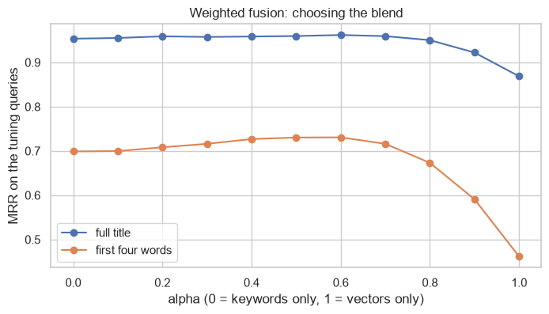

# Keyword, vector or hybrid? Search over 5,000 arXiv papers

[](https://github.com/Sammyjoseph999/arxiv-hybrid-search/actions/workflows/tests.yml)

Hybrid search, which combines keyword matching with vector similarity, is often presented as strictly better than either alone. This project measures that on 5,000 recent arXiv abstracts, and then measures what a metadata filter costs on three search engines.

Everything runs locally with open models. No API key is needed.

## Results

### Finding a specific paper

The query is a paper's title; a hit means that paper's abstract is ranked first among all 5,000. Results are on 500 held-out queries.

| Retriever | Full title, ranked first | First four words, ranked first |
|---|---|---|
| Keyword (BM25) | 93.2% | 65.8% |
| Vector (MiniLM embeddings) | 84.2% | 37.4% |
| Hybrid: reciprocal rank fusion | 92.0% | 55.4% |
| Hybrid: weighted fusion, tuned | 95.8% | 67.2% |

### Adding a reranker

A second stage rescores the weighted hybrid's top 20 with a cross-encoder (`ms-marco-MiniLM-L-6-v2`), which reads the query and each abstract together.

| Query | Hybrid, ranked first | Hybrid + reranker, ranked first | Time per query |
|---|---|---|---|
| Full title | 95.8% | 95.8% | 58 ms |
| First four words | 67.2% | **72.6%** | 57 ms |

It helps exactly where the first stage is weakest, short queries, and costs about a thousand times more than the search itself. On topical search it is slightly worse (69.3% against 70.1% in the next table): the model was trained to judge whether a passage answers a question, not whether two papers share a subject.

### Finding papers on a subject

Share of the top ten results in the same arXiv category as the query paper:

| Retriever | Same category |
|---|---|
| Keyword (BM25) | 58.5% |
| Vector | 70.6% |
| Hybrid: reciprocal rank fusion | 69.5% |
| Hybrid: weighted fusion | 70.1% |

### What this says

- **For a known item, keywords win; for a topic, vectors win.** Neither retriever is better in general.
- **Hybrid is not automatically better.** Reciprocal rank fusion was worse than plain BM25 on known-item search, because it gives the weaker retriever an equal vote. Weighted fusion beat both single retrievers there by a point or two, but only after its weight was tuned on separate queries.
- **A reranker is a targeted fix, not a free upgrade.** It added five points on short queries, nothing on full titles, and lost a little on topical search.
- **The two retrievers miss different things.** On short queries, keyword search found 114 papers in its top ten that vector search missed, and vector search found 22 that keywords missed.



### Metadata filters

Median time for a top-ten vector query over 5,000 papers, on a laptop:

| Filter | NumPy (exact) | ChromaDB (HNSW) | Qdrant (local mode) |
|---|---|---|---|
| None | 0.05 ms | 0.47 ms | 1.2 ms |
| Category | 0.06 ms | 2.3 ms | 15 ms |
| Date | 0.04 ms | 3.3 ms | 15 ms |
| Category + date | 0.05 ms | 2.9 ms | 17 ms |

- Filters make ChromaDB's queries several times slower and Qdrant's local mode about twelve times slower. Both still return the same results as exact search (99.6% agreement or better).
- At this size, exact search with a boolean mask is the fastest option by a wide margin. An approximate index has nothing to speed up at 5,000 vectors.
- Timings will vary by machine. Qdrant's local mode is a development convenience and says little about a Qdrant server; at millions of vectors exact search stops being an option and the comparison changes.

The practical conclusion: measure the simple version first. A vector database, and hybrid search, are worth adding when a measurement shows they help.

## How it works

| File | Purpose |
|---|---|
| `hybridsearch/fetch.py` | Downloads paper metadata from the public arXiv API |
| `hybridsearch/retrievers.py` | BM25, cosine search, weighted fusion and reciprocal rank fusion |
| `hybridsearch/rerank.py` | Second-stage reranking of the top candidates with a cross-encoder |
| `hybridsearch/evaluate.py` | Rank, recall@k, MRR and category precision |
| `hybridsearch/backends.py` | The same filtered search on NumPy, ChromaDB and Qdrant, with timing |
| `notebook.ipynb` | The experiments and results |

The fusion weight is chosen on 500 tuning queries and reported on a separate 500, so it is not tuned on the numbers it is judged by.

## Running it

```bash
pip install -r requirements.txt
jupyter notebook notebook.ipynb
```

`data/arxiv_papers.csv` is included: 1,000 recent papers from each of cs.CL, cs.CV, cs.DB, cs.LG and cs.SE, fetched in October 2026. To fetch a fresh set (about two minutes, respecting arXiv's rate limit):

```bash
python -m hybridsearch.fetch
```

## Tests

```bash
pip install -r requirements-test.txt
pytest
```

## Limits

One embedding model and one corpus. Queries are derived from titles, which are written by the same authors as the abstracts and so favour keyword matching more than real user queries would. Category precision is a coarse measure, since the five categories overlap.

## Data

Paper metadata comes from the [arXiv API](https://info.arxiv.org/help/api/index.html). Thank you to arXiv for use of its open access interoperability.

## License

The code is released under the [MIT License](LICENSE). Datasets keep the terms of their original sources, described above.
